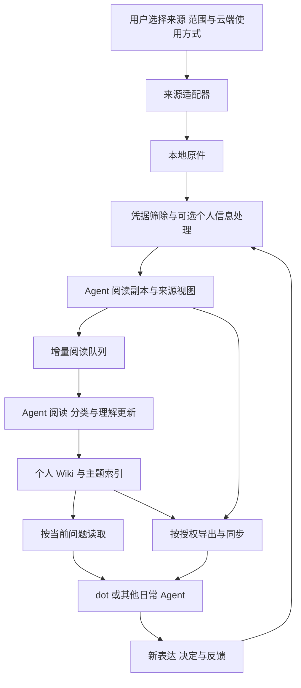

# Personal Agent Harness 架构

更新时间：2026-10-12。主职责：说明个人上下文的生命周期、运行模块和可复用边界。

用户的表达和经历分散在不同应用，聊天上下文又有范围与长度限制。Harness 将可用材料独立保存，持续维护有日期与出处的个人理解，再按任务选择相关内容。新表达和实际反馈回写同一理解主落点，使后续交流接续更新后的认识。

## 数据流



本地原件由用户保存；启用凭据筛除的来源先生成处理后的阅读副本，再提供给模型。当前基础工具先覆盖微信，其他来源按用户选择配置。来源定位保留原件身份、消息或交易位置，并为云端提供实际可访问的副本位置。

## 模块与职责

| 模块 | 输入与输出 | 实现方式 |
| --- | --- | --- |
| 配置引导 | 用户目标、来源选择、操作结果 → 工作区配置和下一步说明 | dot 对话引导，本地 CLI 承接操作；配置可被后续界面复用 |
| 来源适配 | 已启用来源与范围 → 原件、可读记录、出处和实际采集范围 | 复用现有导入器，按来源扩展 |
| 凭据处理 | 原件中待阅读的文本和结构字段 → 脱敏副本、处理位置与数量 | 本地确定性规则；歧义交给用户或 Agent 判断 |
| 上下文存储 | 脱敏来源、当前理解、阅读和同步状态 | Markdown、JSON；消息合并沿用 SQLite |
| 理解维护 | 来源、已有 Wiki、当前任务 → Wiki 更新、主题、阅读回执 | 由 Agent 语义处理，脚本记录状态 |
| Agent 接入 | 读取约定、提示词、工作区与可用工具 → 日常调用和反馈回写 | 首先支持 dot，后续支持其他运行环境 |
| 导出与同步 | 用户许可范围与上次已交付记录 → 本次包、远端引用和应用结果 | 与具体传输工具分开 |

## 最小公共接口

当前接口由 personal_agent/core.py、adapters.py、runtime.py、delivery.py 和统一 CLI 实现。具体参数见[命令与协议](commands.md)。

- 来源适配器接受来源配置与上次进度，返回实际读取范围、原件引用、记录和新进度。需要登录或导出时返回具体操作说明；其他已启用来源继续处理。
- 凭据处理接受选定记录，返回 Agent 可用副本与不包含秘密值的处理说明。
- 消化入口列出未读、已变更或部分读完的材料；完成阅读后记录当时版本、主题、理解页、结论与续读位置。
- Agent 接入负责把读取规则、相关材料和可用操作交给当前运行环境；反馈更新对应 Wiki。
- 传输适配器接受导出文件，返回真实交付引用和结果。上传、云端解包、Wiki 合并和 Agent 使用分别记录。

接口使用 Python 函数与 CLI。外部 Agent 和上传环境通过 stdin/stdout 接入；dot 使用真实文件操作和 instructions 完成语义处理。

## 用户工作区

```text
PersonalContext/
  config.json                 来源范围、云端使用方式与用户时区
  raw/                        本地原件，不作为默认 Agent 阅读入口
  agent-context/
    AGENTS.md                 个人库读取与维护约定
    README.md                 薄地图
    sources/                  脱敏来源视图与可回查副本
    wiki/                     可修订的个人认识
    state/                    阅读进度与主题索引所需状态
  state/                      本地采集、导出与同步进度
  exports/                    按配置生成的脱敏包
  dot-context/                当前提供范围的日常发布副本
```

当前实现已分开原件、处理上下文和 dot 日常发布副本。包内携带工具与相对路径；Wiki-only 来源保留身份，全文继续在提供端保存。模板见 [上下文库模板](../templates/context/README.md)。

## 个人理解如何生长

原文提供证据，Wiki 维护当前认识。明确事实、用户决定与分析理解分别表达；重要经历保留全文原件，摘要连接原文。持续主线与阶段话题分别判断，材料数量不直接代表个人重要性。

每条事实拥有一个主落点，其他页面用链接复用。变化先比较日期、表达者、对象与主张，再更新原条目。一般工作指令可以只分类；其中关于本人背景、能力或协作要求的明确表达仍可进入 Wiki。

用户提出当前问题时，先读薄地图和相关理解页，需要确认原话或处理矛盾时再进入来源。保存完整材料和每轮按需读取各自解决不同问题。

## 运行方式

采集完成后衔接凭据处理与消化；理解更新后衔接用户已启用的同步。周期任务补取新材料并继续未消化历史。各阶段记录完成位置，后续从该位置续接。

模型、dot、文件工具和调度系统属于运行环境。Harness 保存工作流程与状态，并据实际能力安排执行；这让其他 Agent 可以复用个人上下文而保留自己的工具与交互方式。
